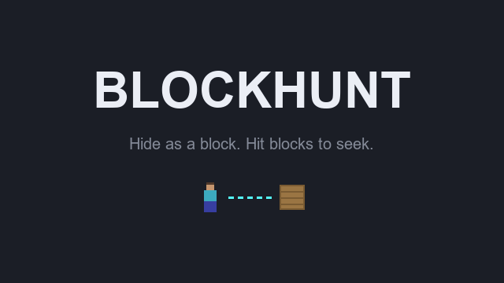

# BlockHunt

A hide-and-seek mini-game plugin for Minecraft servers where hiders turn into blocks.

Hiders are disguised as a block that follows them around. Standing still, they snap onto the grid
and become indistinguishable from the map. Seekers hit suspicious blocks to find them: a hider who
is found joins the seekers. Seekers win when nobody is left hiding, hiders win when the clock runs
out.



## Building

Ready-made jars are on the [Releases](../../releases) page, each with its SHA-256 and a build
provenance attestation (`gh attestation verify BlockHunt-<version>.jar --repo oodinhoo/BlockHunt`).

Building from source requires **JDK 25** (mandatory since Minecraft 26.1).

```powershell
.\gradlew.bat build      # -> build/libs/BlockHunt-1.1.0.jar
.\gradlew.bat runServer  # starts a local Paper 26.3 test server with the plugin
```

Built against `io.papermc.paper:paper-api:26.3.build.227-stable` (Gradle 9.8.2). Drop the jar into
the `plugins/` folder of a **Paper 26.3** server.

## Running a game

1. Stand in the arena and run `/bh setspawn`.
2. Every player runs `/bh join`. Each join tells the players who did not join yet in chat, with a
   clickable **[Join]**.
3. Once `min-players` joined (2 by default), a 30 second countdown starts, and the game with it.
   A player leaving under the minimum stops the countdown. An admin can `/bh start` at once.

Joining shows a title and a lobby sidebar that stays on screen: the status (*Need 1 more*,
*Starts in 0:25*, or *No spawn set* for the admin), the players who joined, the length of both
phases, and how to leave. During the game, the same sidebar shows your role. At the end, the lobby
comes back with the same players, and the countdown for the next game starts again: a chat
message with a clickable **[Leave]** gets a player out of it.

Everyone is teleported to the arena. Each player's inventory and game mode are put aside and given
back at the end of the game, or when they leave it, and they are taken back where they stood
before the game. This holds even after a server crash (on their next join); a player whose world
was deleted meanwhile lands at the main world's spawn. A part of it that cannot be read back is
logged in the server console and kept in the player's data, under a `blockhunt:<part>-unreadable`
key, while the rest is given back. During the game, everyone is in adventure
mode and cannot break, place, drop or pick up anything. The only commands that work for them are
`/bh` (or `/blockhunt`) ones: another plugin's `/home`, `/tpa` or `/sell` would get a frozen seeker out of the wait,
or a copied block out of the game.

| Phase | Default | What happens |
|---|---|---|
| Hiding | 30 s | Seekers are blinded and frozen, hiders run and hide |
| Seeking | 5 min | Seekers hunt. Time out: hiders win |

When the last seeker leaves the game, a hider picked at random takes their place, blind and frozen
like them during the hiding phase. With a single hider left, nobody is left to hunt them: the
hiders win.

### The dome

The game is played in a sphere of `arena-radius` blocks (40 by default) around the arena spawn: a
dome above the ground, and as deep below it, caves included. During a game:

- its players cannot leave it, walking, flying, or with an ender pearl or a chorus fruit. One sent
  outside by a teleport (another plugin, an admin's `/tp`) is brought back within a second; one
  sent to another world leaves the game;
- nobody else can enter it. Anyone standing in it when the game starts, or logging in inside it
  during a game, is set down outside, off their mount if they ride one;
- its wall shows as cyan particles to whoever comes within 6 blocks of it, from inside or outside.

Nothing is built in the world, and between games the dome is gone: the arena is free to build in.
Teleports by a plugin and admin commands such as `/tp` go through the wall.

## Playing as a hider

You are invisible: the others only see the block you are disguised as, following you.

- **Stand still for 3 seconds** on solid ground: you snap onto the grid and become a real-looking
  block. Moving again turns you back. The XP bar fills up as you stay still.
- **Right-click a block of the map** to take its look, once every 30 seconds (the cooldown shows on
  slot 1). Blocks that are not solid (flowers, torches, grass, carpets) and blocks with their
  own renderer (chests, signs, beds) cannot be copied, nor blocks drawn invisible (barriers, light
  blocks), which would make you invisible.
- **Taunt** (rocket, slot 2): a loud goat scream at your position, paid back by time off the clock.
  The closer to a seeker, as the crow flies and through walls, the more: 30 seconds right next to
  one, 15 at 16 blocks, nothing from about 32 blocks, where the taunt is refused and kept. Near the
  end, it takes off only what is left above the last second. Once the seekers are released, your
  sidebar shows what a taunt would take off now. Two per hider.
- **Giving up** with `/bh leave` once the seekers are released counts as a find for the nearest
  seeker. A disconnection does not.

## Playing as a seeker

- **Hit a suspicious block.** If it is a hider, they are found and join the seekers.
- **Sonar** (recovery compass, slot 2): right-click to hear a bell at every hider's position. Every
  45 seconds. Not a plain compass, which WorldEdit uses as its teleport wand.
- **Hot or cold**: your XP level is the distance to the nearest hider, the action bar says *Hot!*,
  *Warm...* or *Cold*.

Both roles get a sidebar with the game state, and a boss bar with the time left.

## Commands and permissions

| Command | Permission | Default |
|---|---|---|
| `/bh join`, `/bh leave` | none | everyone |
| `/bh start` | `blockhunt.admin` | operators. Starts at once, without waiting for the countdown |
| `/bh setspawn` | `blockhunt.admin` | operators |
| `/bh disguise <block>` | `blockhunt.admin` | operators. Toggles a disguise outside a game, for testing |

`/blockhunt` is the long form of `/bh`.

## Configuration

`plugins/BlockHunt/config.yml`:

| Key | Default | Meaning |
|---|---|---|
| `min-players` | `2` | Players in the lobby before the countdown starts (2 at least) |
| `countdown-seconds` | `30` | Length of the countdown before a game starts on its own |
| `hide-seconds` | `30` | Length of the hiding phase |
| `seek-seconds` | `300` | Length of the seeking phase |
| `solidify-seconds` | `3` | Time standing still before turning solid |
| `change-cooldown-seconds` | `30` | Cooldown between two block changes |
| `seekers` | `1` | Seekers at the start (at least one hider is always left) |
| `sonar-cooldown-seconds` | `45` | Cooldown of the seekers' sonar |
| `taunts` | `2` | Taunts per hider and per game |
| `taunt-max-seconds` | `30` | Time a taunt takes off the clock right next to a seeker. `0` turns taunts off |
| `taunt-range` | `32` | Distance to the nearest seeker at which a taunt takes nothing off, and is refused |
| `blocks` | 8 full blocks | Starting disguises, one picked at random per hider. Air and blocks drawn invisible (barrier, light, structure void, moving piston) are left out |
| `arena-radius` | `40` | Radius of the dome around the arena spawn, in blocks. `0` turns it off |
| `spawn` | none | Arena spawn, written by `/bh setspawn` |

## Known limits

- **One arena per server.**
- **F3+B is turned off in the arena world during a game** (game rule `reducedDebugInfo`), or it
  would draw every hider's hitbox. A crash mid-game leaves the rule on:
  `/gamerule reducedDebugInfo false` puts it back.
- **The fake block of a solid hider is resent every second**: a block update right next to it can
  make it flicker for up to a second.
- **The dome does not stop mounts**: someone who is not in the game can ride a horse or a boat into
  it. Players of the game cannot mount anything.

## Documentation

- [Contributing](CONTRIBUTING.md) — building, testing and getting a change merged.
- [Continuous integration](docs/ci.md) — what runs on a pull request and a release, and what to do when it fails.
- [Security policy](SECURITY.md) — how to report a vulnerability privately.

## License

[MIT](LICENSE)
